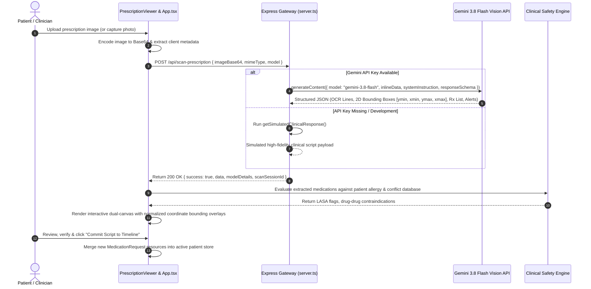
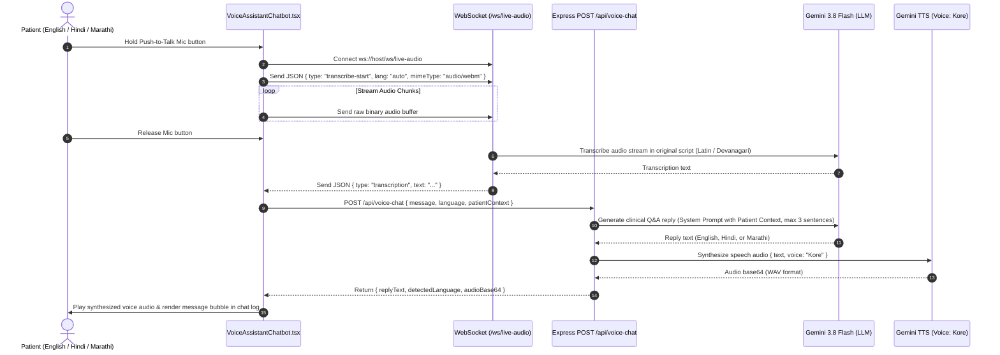
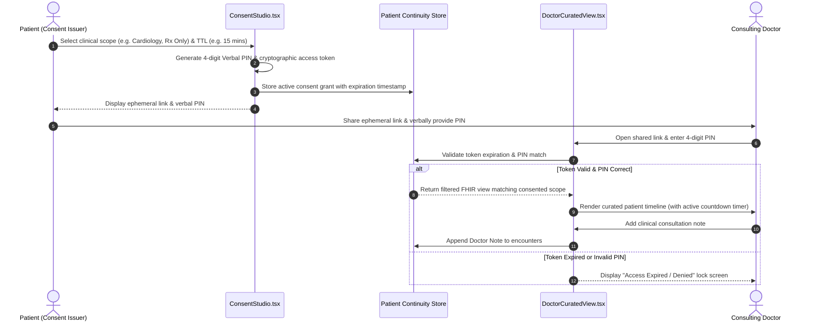
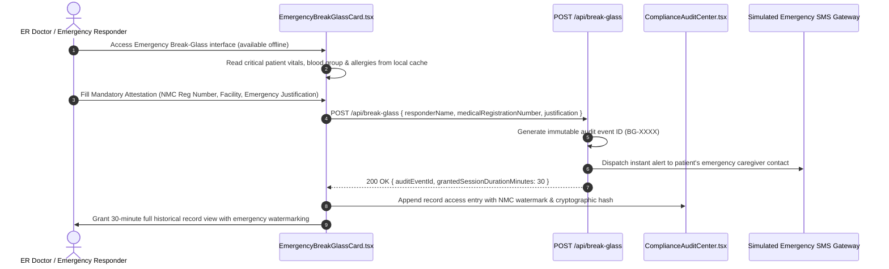

# MediScript: Stack Communication & System Architecture

This document specifies the end-to-end stack communication architecture, data flows, communication protocols, and interface boundaries of the **MediScript Healthcare Continuity Platform**.

---

## 1. High-Level Stack Architecture

```mermaid
flowchart TD
    subgraph ClientLayer["Frontend Client Layer (Vite + React 19 + TypeScript + Tailwind CSS)"]
        UI["Navigation & UI Shell<br/>(Navbar, Theme, PatientProfileSwitcher)"]
        TimelineView["Health Timeline<br/>(FHIR R4 Records & History)"]
        PrescriptionStudio["Prescription Studio & OCR Viewer<br/>(Dual-Canvas 2D Bounding Boxes)"]
        WhatsAppSim["WhatsApp Ingestion Simulator<br/>(Simulated Messaging Webhook)"]
        SafetyInspector["Clinical Safety Inspector<br/>(Drug Interactions & LASA Engine)"]
        ConsentPortal["Consent Studio & Doctor Portal<br/>(TTL Ephemeral Pass & Verbal PIN)"]
        EmergencyPass["Emergency Break-Glass Card<br/>(Offline QR Pass & Attestation)"]
        VoiceCompanion["Voice Assistant Companion<br/>(Multilingual STT / TTS Audio UX)"]
        LocalCache[("Client LocalStorage & Cache<br/>(Offline Pass & Active Profiles)")]
    end

    subgraph TransportLayer["Transport & Network Layer"]
        HTTP_REST["HTTPS / REST API<br/>(JSON Payloads, max 35MB)"]
        WS_STREAM["Secure WebSocket (WSS)<br/>(/ws/live-audio binary stream)"]
        ClientEvents["DOM / React State Bus<br/>(Synchronous In-Memory Dispatches)"]
    end

    subgraph BackendLayer["Backend Application Gateway (Node.js / Express / tsx)"]
        ExpressServer["Express HTTP Server (server.ts)"]
        WSServer["WebSocket Server (/ws/live-audio)"]
        StaticServer["Vite Dev Middleware / Static Assets"]
        
        subgraph Endpoints["API Controllers & Handlers"]
            ScanAPI["POST /api/scan-prescription<br/>(Base64 Image Parsing)"]
            VoiceAPI["POST /api/voice-chat<br/>(Multilingual LLM + TTS)"]
            FhirAPI["POST /api/export-fhir<br/>(HL7 FHIR R4 Bundle Serializer)"]
            BreakGlassAPI["POST /api/break-glass<br/>(Emergency Attestation & Audit)"]
            HealthAPI["GET /api/health<br/>(Telemetry & Health Check)"]
        end
        
        subgraph FallbackEngine["Clinical Simulation Engine"]
            SimulatedOCR["Simulated Clinical OCR Generator"]
            SimulatedVoice["Multilingual Rule Fallback (EN/HI/MR)"]
        end
    end

    subgraph ModelLayer["AI & Clinical Intelligence Tier"]
        GeminiVision["Gemini 3.8 Flash (Vision-Language)<br/>(Spatial Attention & Bounding Boxes)"]
        GeminiTTS["Gemini 3.8 Flash-Lite TTS<br/>(Indian Medical Voice - Kore)"]
        GeminiAudioSTT["Gemini Audio Transcription<br/>(Real-Time WebSocket Speech-to-Text)"]
    end

    subgraph StandardsLayer["Health Interoperability & Compliance"]
        ABHA["ABDM / ABHA Architecture<br/>(National Health Identity)"]
        FHIR_R4["HL7 FHIR R4 / NRCES Standard<br/>(Bundles: Patient, Rx, Condition)"]
        DPDP["DPDP Act 2023 Compliance<br/>(Cryptographic Audit Ledger & Erasure)"]
        CDSCO["Indian Pharmacopeia & CDSCO<br/>(Trade Name & Drug Safety Matrix)"]
    end

    %% Client Internal Connections
    UI --> ClientEvents
    TimelineView <--> LocalCache
    EmergencyPass <--> LocalCache
    ClientEvents --> TimelineView
    ClientEvents --> PrescriptionStudio
    ClientEvents --> SafetyInspector

    %% Client to Transport
    PrescriptionStudio -->|"POST /api/scan-prescription"| HTTP_REST
    WhatsAppSim -->|"POST /api/scan-prescription"| HTTP_REST
    VoiceCompanion -->|"POST /api/voice-chat"| HTTP_REST
    VoiceCompanion -->|"Binary Audio Packets"| WS_STREAM
    TimelineView -->|"POST /api/export-fhir"| HTTP_REST
    EmergencyPass -->|"POST /api/break-glass"| HTTP_REST
    UI -->|"GET /api/health"| HTTP_REST

    %% Transport to Backend
    HTTP_REST --> ExpressServer
    WS_STREAM --> WSServer
    ExpressServer --> Endpoints

    %% Backend to Simulation or Gemini
    ScanAPI -->|"With API Key"| GeminiVision
    ScanAPI -.->|"Without API Key"| SimulatedOCR
    VoiceAPI -->|"Chat Prompt"| GeminiVision
    VoiceAPI -->|"Audio Synthesis"| GeminiTTS
    VoiceAPI -.->|"Fallback NLP"| SimulatedVoice
    WSServer -->|"Binary Buffer Stream"| GeminiAudioSTT

    %% Standards Mapping
    FhirAPI --- FHIR_R4
    FhirAPI --- ABHA
    SafetyInspector --- CDSCO
    BreakGlassAPI --- DPDP
```



---

## 2. Sequence Diagrams for Core Communication Flows

### 2.1 Multimodal Prescription OCR & Ingestion Pipeline



---

### 2.2 Push-to-Talk Real-Time Multilingual Voice Assistant



---

### 2.3 Ephemeral Doctor View & Consent-Gated Access



---

### 2.4 Break-Glass Emergency Offline Pass & DPDP Audit



---

## 3. Communication Protocols & Data Payload Specifications

| Channel | Endpoint / Route | Protocol | Payload Type | Typical Size | Latency Budget | Purpose |
|:---|:---|:---|:---|:---|:---|:---|
| **OCR Ingestion** | `/api/scan-prescription` | HTTPS POST | JSON (Base64 Image) | 2 MB – 30 MB | 800ms – 2500ms | High-res Rx image transcription & 2D coordinate box parsing |
| **Voice Chat** | `/api/voice-chat` | HTTPS POST | JSON | < 10 KB | 500ms – 1200ms | Conversational clinical assistant query & TTS audio generation |
| **Voice Streaming** | `/ws/live-audio` | WSS Binary / Text | Binary Audio Buffers | ~4 KB / frame | < 150ms | Real-time push-to-talk speech-to-text transcription |
| **FHIR Export** | `/api/export-fhir` | HTTPS POST | JSON (FHIR Bundle) | 20 KB – 200 KB | < 100ms | ABDM / NRCES compliant HL7 FHIR R4 Bundle packaging |
| **Emergency Break-Glass** | `/api/break-glass` | HTTPS POST | JSON | < 5 KB | < 200ms | Clinician registration attestation & SMS notification trigger |
| **Health Check** | `/api/health` | HTTPS GET | JSON | < 1 KB | < 20ms | Server readiness, active Gemini model & telemetry probe |

---

## 4. Security, Identity & Regulatory Boundaries

```mermaid
flowchart LR
    subgraph Sovereign["Patient Sovereign Boundary"]
        ABHA_ID["ABHA ID (e.g., 91-8492-3810-4491)"]
        LocalData["Browser In-Memory & LocalStorage"]
        ConsentGrant["Ephemeral Token & PIN Grant"]
    end

    subgraph TransportSec["Transport Security"]
        TLS["TLS 1.3 / HTTPS"]
        WSS_SEC["WSS WebSocket Stream"]
    end

    subgraph ServerSec["Server & Service Isolation"]
        EnvKeys["Strict Server-Side GEMINI_API_KEY (Never sent to browser)"]
        AuditLedger["DPDP 2023 Tamper-Evident Audit Ledger"]
        Watermarking["NMC Reg Number Watermarking on Break-Glass"]
    end

    subgraph National["National Health Grid"]
        NRCES_FHIR["NRCES / HL7 FHIR R4 Standard"]
        CDSCO_DB["CDSCO Indian Pharmacopeia Grounding"]
    end

    Sovereign <-->|Encrypted| TransportSec
    TransportSec <--> ServerSec
    ServerSec --- National
```



1. **API Key Isolation**: The `GEMINI_API_KEY` is loaded strictly server-side in `server.ts` via `dotenv` and is never exposed to the client bundle.
2. **Offline Resilience**: Critical emergency vitals, blood group, allergies, and emergency contacts are cached locally, allowing the Break-Glass Pass to function even under zero internet connectivity in rural or disaster situations.
3. **DPDP Act 2023 Alignment**:
   - Purpose-bound consent with granular scoping (Cardiology, Diagnostic Labs, or Full Timeline).
   - Enforced expiration (TTL between 15 minutes to 48 hours).
   - Zero-knowledge ephemeral viewing where doctors cannot persist data outside the session.
   - Right to erasure and cryptographic audit records for every record access event.

---

## TOON Specification

````toon
stack_components[10]{name,type,layer,tech,protocol,responsibility}:
  Navbar,Component,Client,React/TS,Local,App header brand and quick profile switcher
  HealthTimeline,Component,Client,React/TS,Local,Longitudinal FHIR medical record visualizer
  PrescriptionViewer,Component,Client,React/TS,Local,Dual canvas 2D bounding box OCR reviewer
  WhatsAppIngestionSimulator,Component,Client,React/TS,Local,Simulates asynchronous chat Rx uploads
  ClinicalSafetyInspector,Component,Client,React/TS,Local,Drug-drug interaction and LASA conflict engine
  ConsentStudio,Component,Client,React/TS,Local,Time-to-live sharing passes and PIN issuance
  EmergencyBreakGlassCard,Component,Client,React/TS,Local,Offline cryptographic emergency pass with QR
  VoiceAssistantChatbot,Component,Client,React/TS,WSS/HTTP,Multilingual STT/TTS voice consultation
  ExpressServer,Gateway,Backend,Node/Express,HTTP,API endpoints routing and security middleware
  WebSocketServer,Gateway,Backend,ws/Node,WSS,Push-to-talk low latency binary audio streaming

endpoints[6]{path,method,protocol,payload_format,auth_model,handler}:
  /api/health,GET,HTTP,JSON,Public,Telemetry and model readiness status
  /api/scan-prescription,POST,HTTP,JSON (Base64),API Key (Server),Gemini 3.8 Flash Vision OCR parser
  /api/voice-chat,POST,HTTP,JSON,API Key (Server),Gemini multilingual LLM and Kore TTS
  /ws/live-audio,CONNECT,WSS,Binary/JSON,Session,WebSocket live audio streaming transcriber
  /api/export-fhir,POST,HTTP,JSON,Session,HL7 FHIR R4 Bundle compiler
  /api/break-glass,POST,HTTP,JSON,NMC Attestation,Emergency override dispatcher and SMS alert
````
